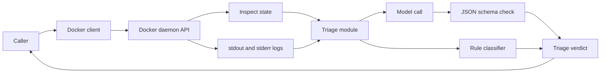

# Dockyard Triage

Async Docker client that explains why containers died, with an LLM reading the logs.



## Why

A container that has already exited is the worst kind of incident: the process is gone, the
only evidence is a log tail, and the first minutes go into guessing whether it was a missing
environment variable, a bad image tag or an out-of-memory kill. Reading a hundred lines of
output by hand does not scale past a couple of services, and the usual dashboards show the
exit code without saying what it means. Dockyard Triage keeps the async Docker client people
already use and adds one step that turns the exit state and the recent logs into a short,
structured verdict.

## How it works

The client talks to the Docker daemon over its HTTP API through aiohttp, with one sub-API
object per resource. The triage step sits on top of the container sub-API: `DockerContainer.triage()`
in `containers.py` calls `triage_container()` in `triage.py`, which asks the daemon for the
container's inspect state through `show()` and its stdout and stderr through `log()`, strips
ANSI colour codes with `_normalise()` and keeps the last 200 lines. Those three sources are
merged into one prompt by `build_prompt()` and sent to the model with a strict JSON schema
(`_VERDICT_SCHEMA`) through `_ask_model()`. The reply is validated by `parse_verdict()` into a
`TriageVerdict` with a category, a one-line cause and up to five log lines that support it.
When no API key is set, the `openai` extra is missing, or the reply does not parse,
`rule_verdict()` and `classify_logs()` produce the verdict from ordered regular expressions,
with exit code 137 read as an out-of-memory kill, so the call never fails because of the model.

## Key decisions

- The triage step lives in the client rather than in a separate service, so a caller that
  already holds a container object needs no new connection or configuration. The cost is that
  the client package now carries a module that talks to a model provider.
- The model dependency is an optional extra. A plain install stays on aiohttp alone, and the
  rule-based classifier covers the no-key case, at the price of two code paths to keep in
  step.
- The model is asked for a fixed JSON schema and the reply is validated before use. A free
  text answer would be easier to prompt for but impossible to render in a table or to test.
- Logs are capped at the last 200 lines and merged from stdout and stderr before the call.
  Longer tails cost more tokens and rarely change the category.

## Tech stack

- Python 3.10 and later, asyncio
- aiohttp for the Docker HTTP API
- OpenAI API for the structured verdict, installed through the `triage` extra
- pytest and pytest-asyncio for the tests
- Docker for the integration tests

## Quick start

Prerequisites: Python 3.10 or later, a reachable Docker daemon, and optionally an OpenAI API
key for the model path.

```bash
uv sync --extra dev --extra lint --extra test --extra doc
uv sync --extra triage
bash test.sh
```

| Variable | What it sets | Default |
| --- | --- | --- |
| `DOCKER_HOST` | Docker daemon address when no URL is passed | first local socket found |
| `DOCKER_CONTEXT` | Docker context name to load the endpoint from | `currentContext` in the Docker config |
| `DOCKER_TLS_VERIFY` | Use TLS for a TCP daemon address | `0` |
| `DOCKER_CERT_PATH` | Directory holding the TLS certificates | none |
| `OPENAI_API_KEY` | Enables the model path of the triage step | unset, rules only |

## Usage

```python
import dockyard_triage

async with dockyard_triage.Docker() as docker:
    container = await docker.containers.get("checkout-worker")
    verdict = await container.triage()
    print(verdict.category, verdict.cause)
```

```text
config_error missing required environment variable DATABASE_URL
```

## Project structure

```text
dockyard_triage/
  docker.py        client entry point and connection handling
  containers.py    container sub-API, inspect, logs and triage
  triage.py        verdict type, rule classifier, model call
  images.py        image sub-API
  services.py      swarm service sub-API
tests/
  test_triage.py   classifier, parsing and fallback tests
  test_containers.py
```

## Limitations

- The rule classifier knows a fixed set of categories and misses failures it has not seen.
- Only the last 200 log lines are sent, so a cause printed early in a long run is not found.
- The model path needs network access and an API key; there is no local model option.
- Verdicts are not cached, so triaging the same container twice calls the model twice.

## License

Apache-2.0. The project builds on [aiodocker](https://github.com/aio-libs/aiodocker), an
async Docker HTTP API client, and keeps its Apache-2.0 licence.
